# 03 · Diagramas de secuencia

Cada flujo indica requisitos (`RF`), pantallas (`P#` del PDF de interfaces), reglas (`RN`) y RPC (`05-contratos-rpc.md`).

Participantes comunes: **UI** (React PWA) · **SW** (Service Worker + IndexedDB) · **API** (Supabase PostgREST/RPC con RLS) · **Auth** (Supabase Auth) · **DB** (PostgreSQL) · **ST** (Storage).

Renderizar con https://mermaid.live, `mmdc`, o directo en GitHub/VS Code.

---

## 1. Registro e inicio de sesión
RF-01 · P1, P2, P3 · RN-40

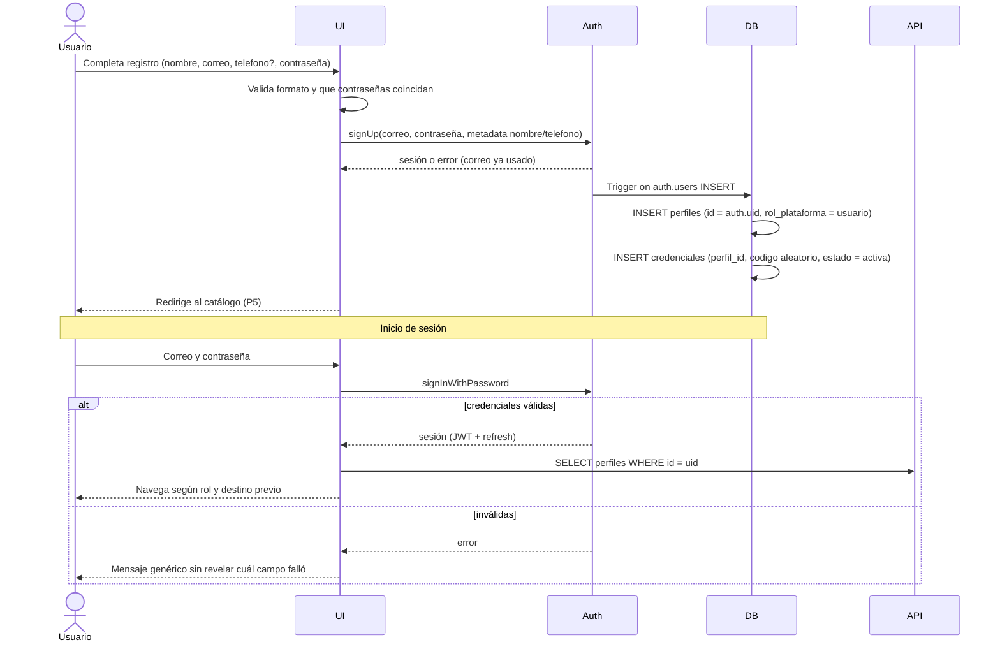

## 2. Solicitud de evento y resolución por administrador
RF-02, RF-03 · P12, P13, P28, P29 · RN-08, RN-10…13, RN-70

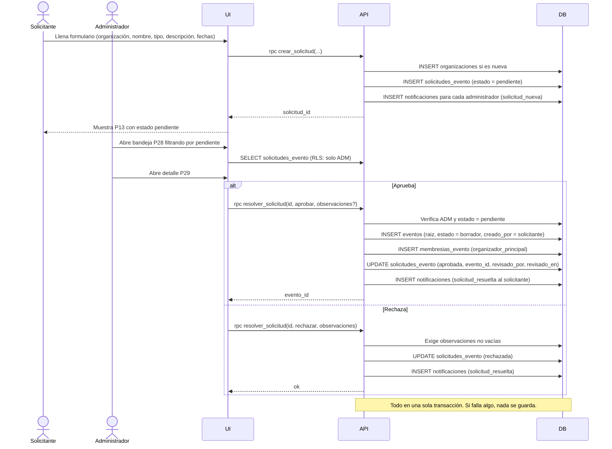

## 3. Crear evento, actividades y publicar
RF-04, RF-05 · P14, P15, P16 · RN-01…07

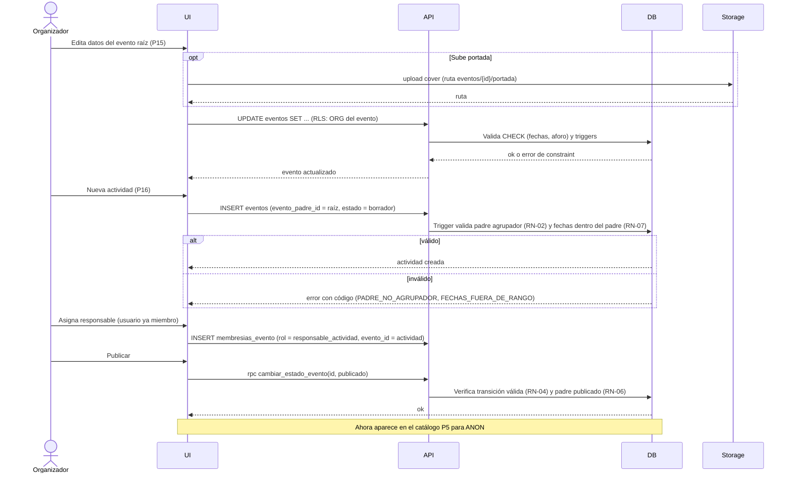

## 4. Invitación y canje de código
RF-06 · P17 · RN-20…23

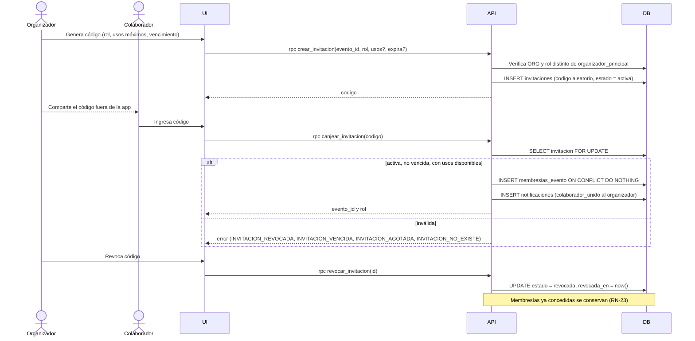

## 5. Inscripción con control de aforo
RF-07, RF-08 · P5, P6, P7, P8 · RN-30…35

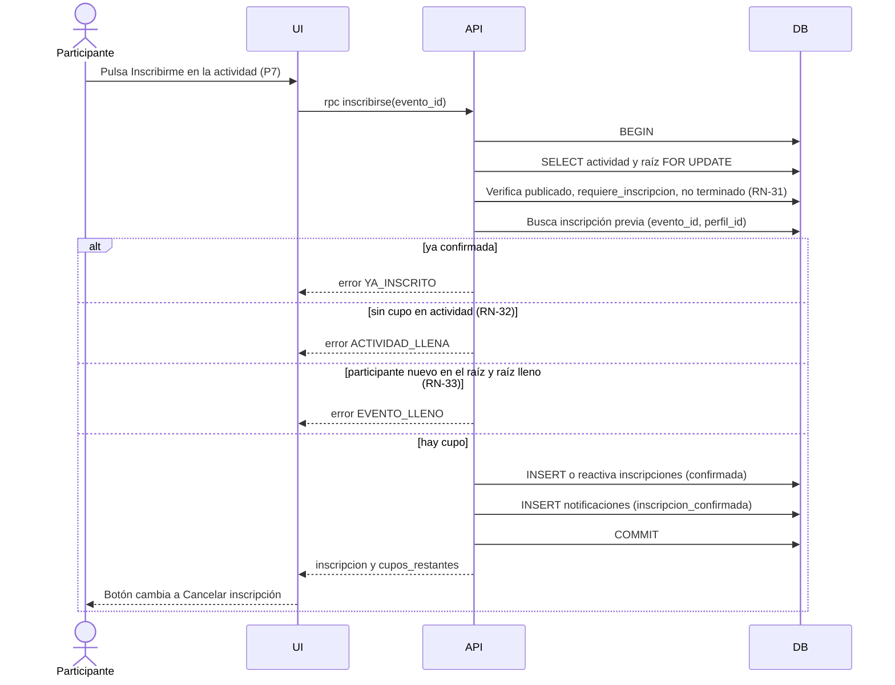

## 6. Cancelar inscripción
RF-07 · P7, P8 · RN-36

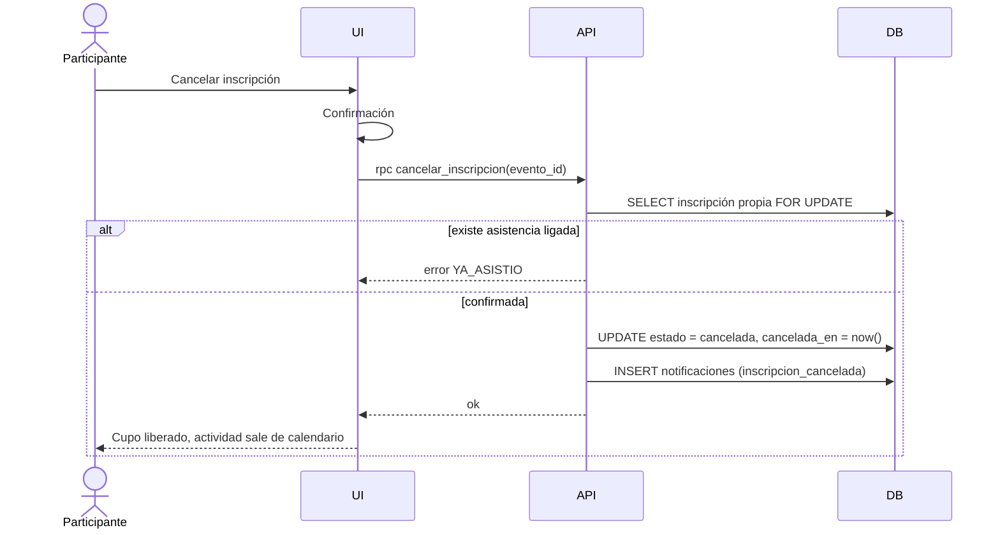

## 7. Mostrar gafete QR (disponible sin conexión)
RF-09 · P10 · RN-40…43

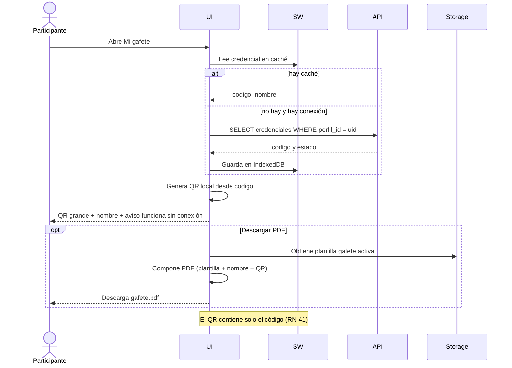

## 8. Escaneo de asistencia en línea
RF-10 · P23, P24, P25 · RN-50…57

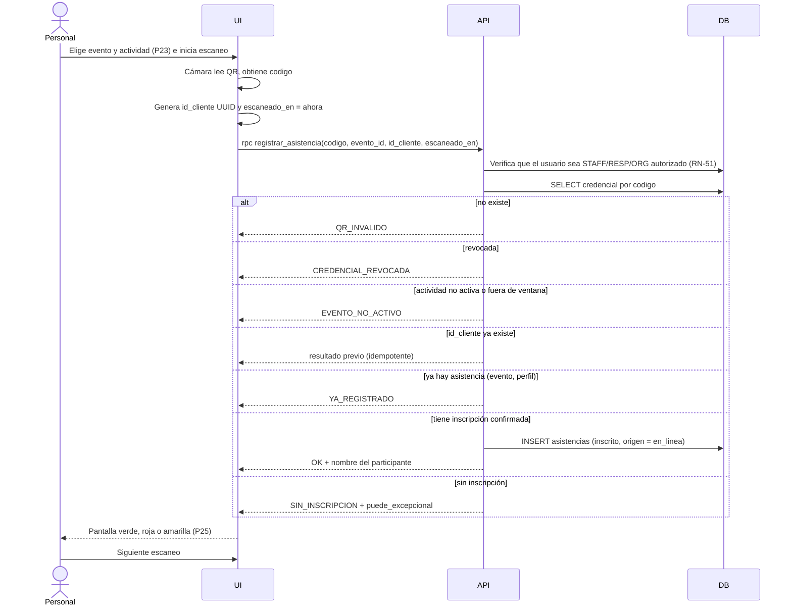

## 9. Entrada excepcional
RF-11 · P25, P26 · RN-54…56

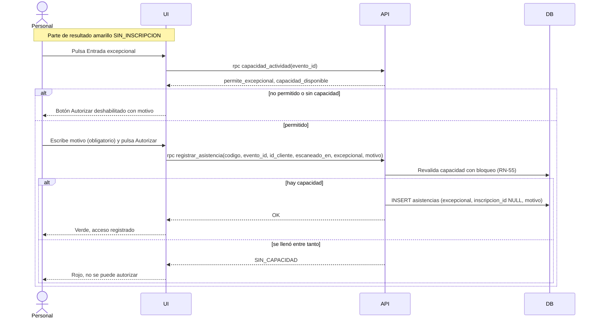

## 10. Escaneo sin conexión y sincronización
RF-12 · P23, P24, P27 · `06-offline.md`

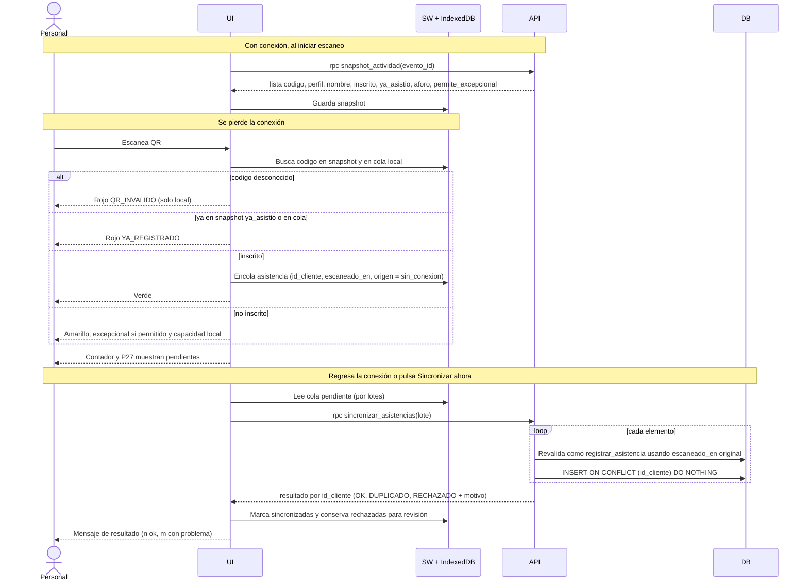

## 11. Plantillas y emisión de constancias
RF-13 · P19, P20 · RN-60…64

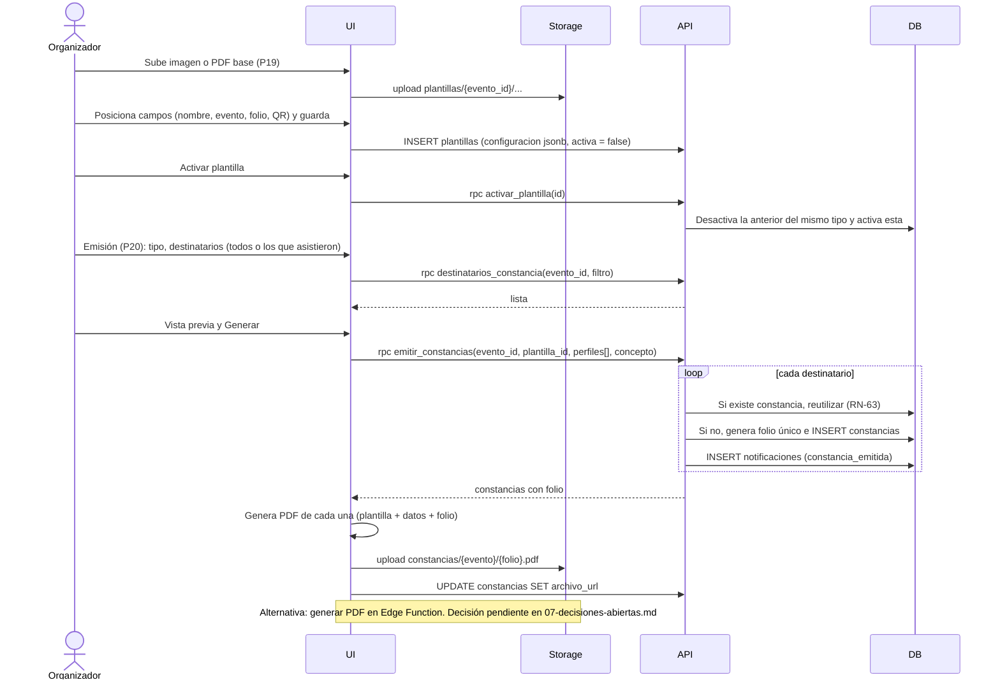

## 12. Descarga de constancia y verificación de folio
RF-13 · P11

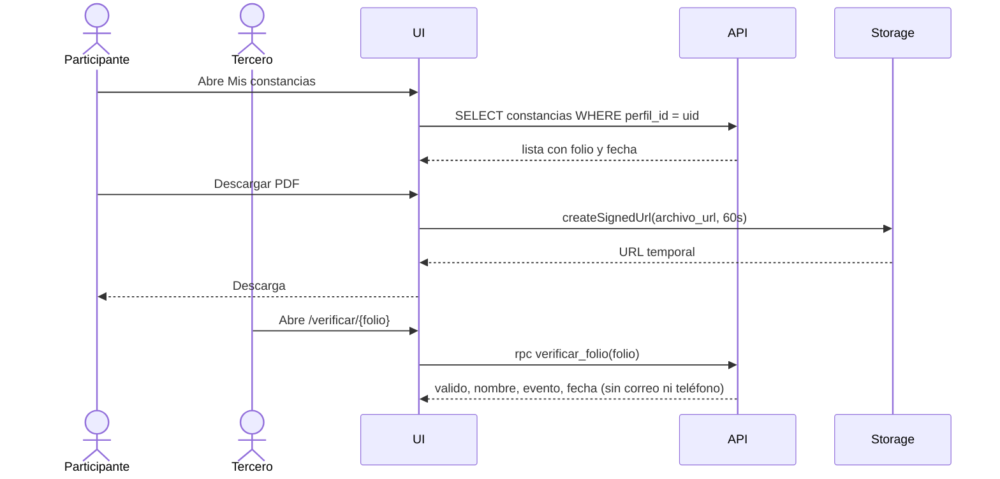

## 13. Reportes
RF-14 · P21 · RN-80…82

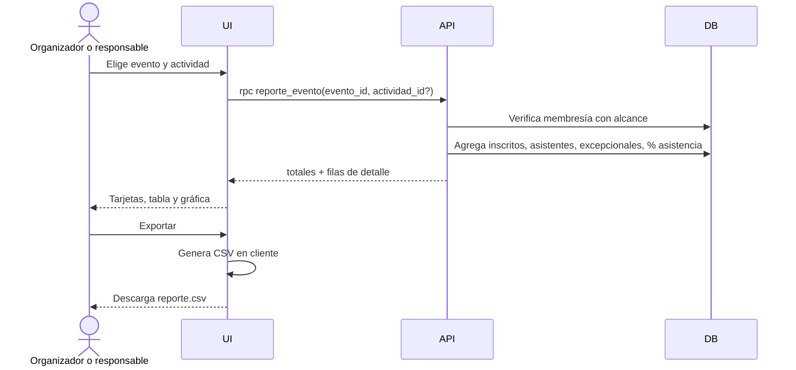

## 14. Notificaciones
RF-15 · P4 · RN-70…72

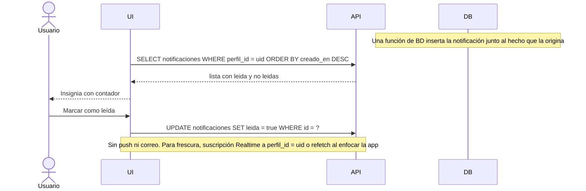

## 15. Cancelar o cerrar un evento (cascada)
RN-04, RN-06 · P14, P15

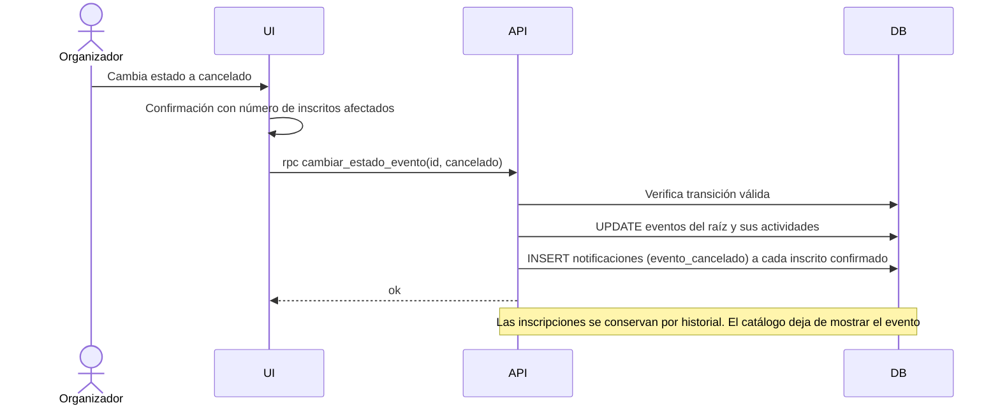
