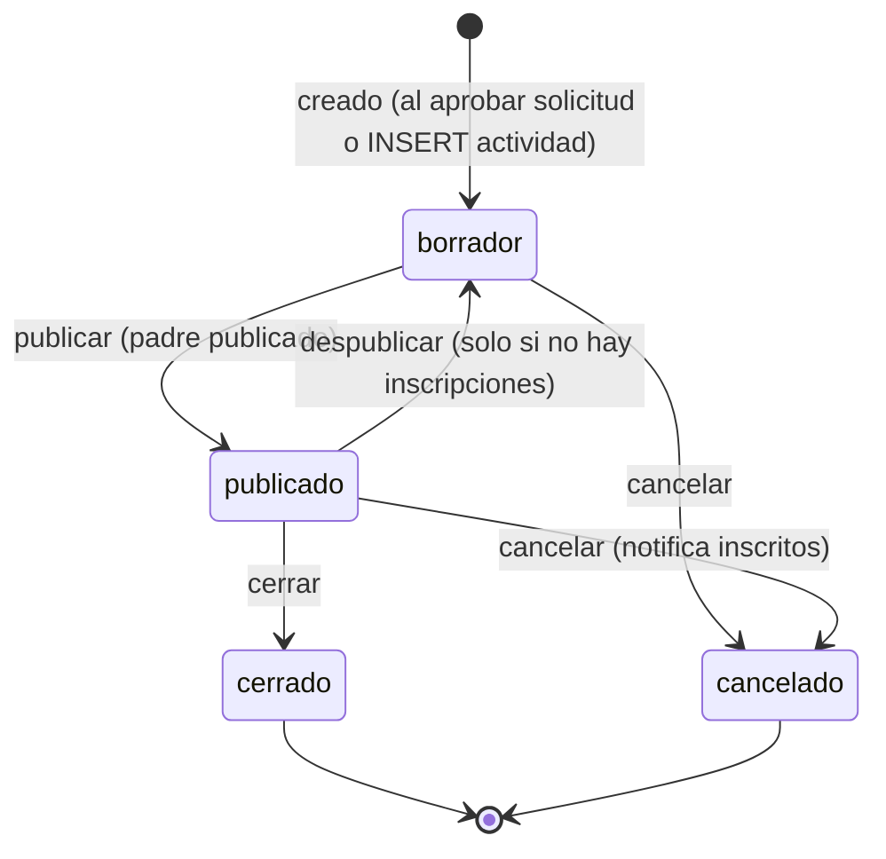
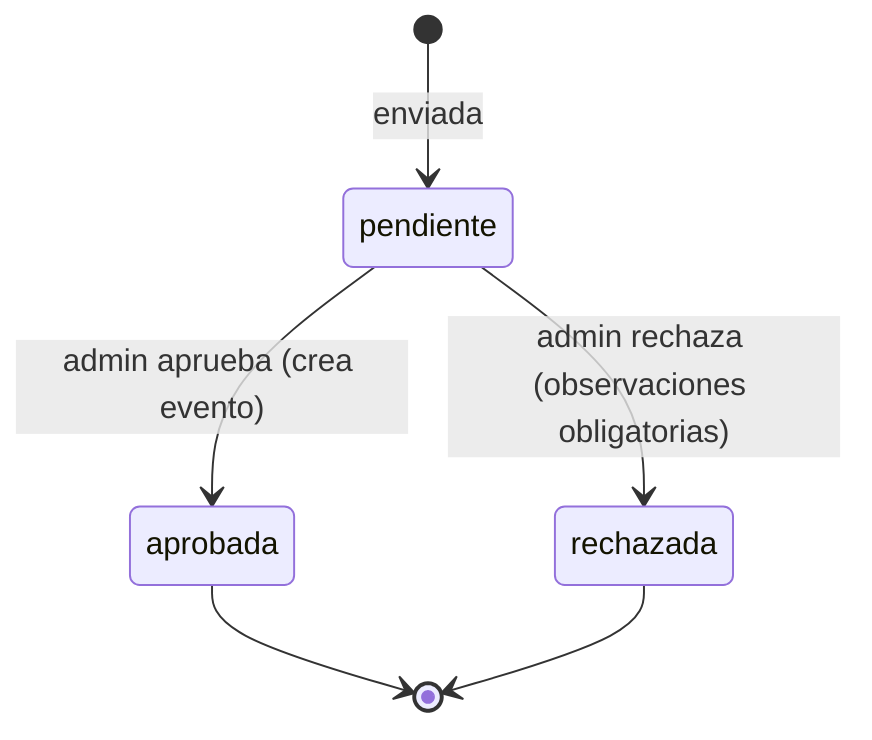
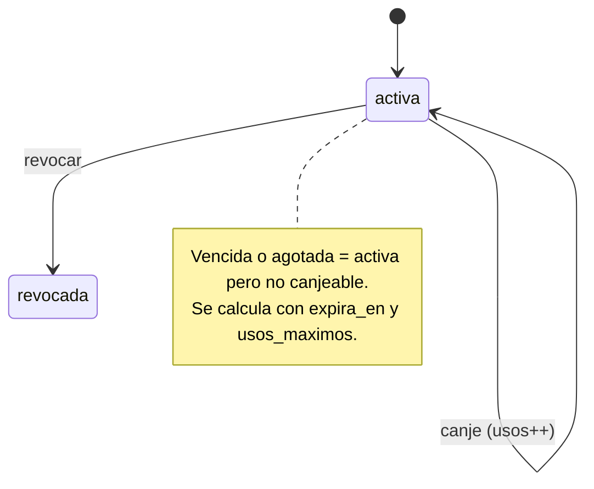
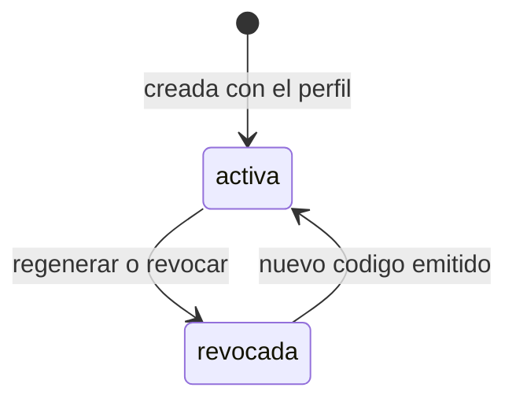
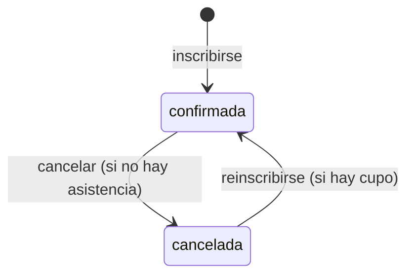
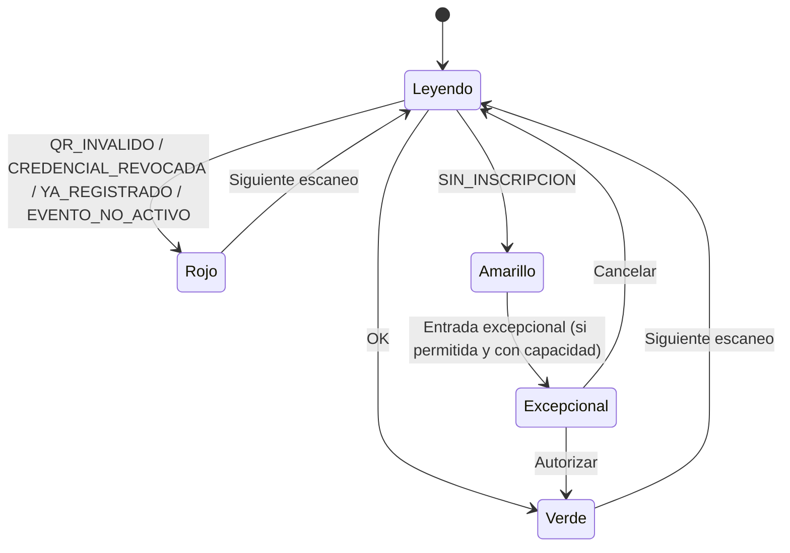
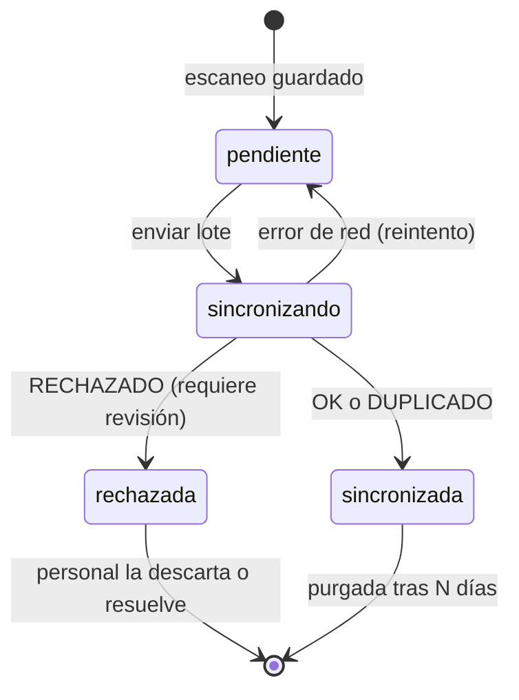

# 04 · Diagramas de estados

Complementan `03-diagramas-secuencia.md`. Las transiciones no listadas están **prohibidas** y la BD debe rechazarlas (trigger o función de transición).

## Evento / actividad (`eventos.estado`) — RN-04, RN-06

- `cerrado`: ya no admite inscripciones ni escaneo, pero permite reportes y emisión de constancias.
- `cancelado`: terminal. Solo lectura.

## Solicitud (`solicitudes_evento.estado`) — RN-10

## Invitación (`invitaciones.estado`) — RN-22

## Credencial (`credenciales.estado`) — RN-42

## Inscripción (`inscripciones.estado`) — RN-30, RN-36

## Resultado de un escaneo (UI P25) — RN-52

## Elemento de la cola offline (IndexedDB) — `06-offline.md`

